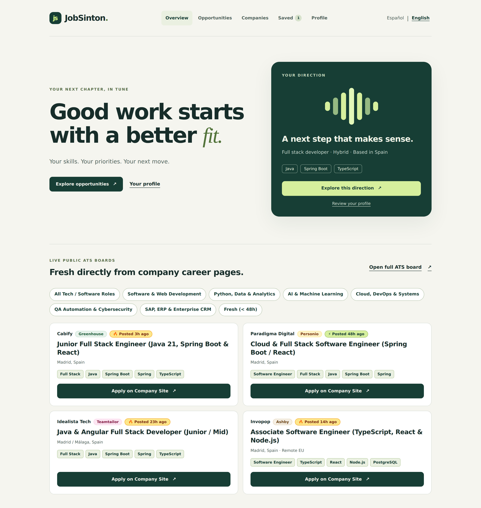
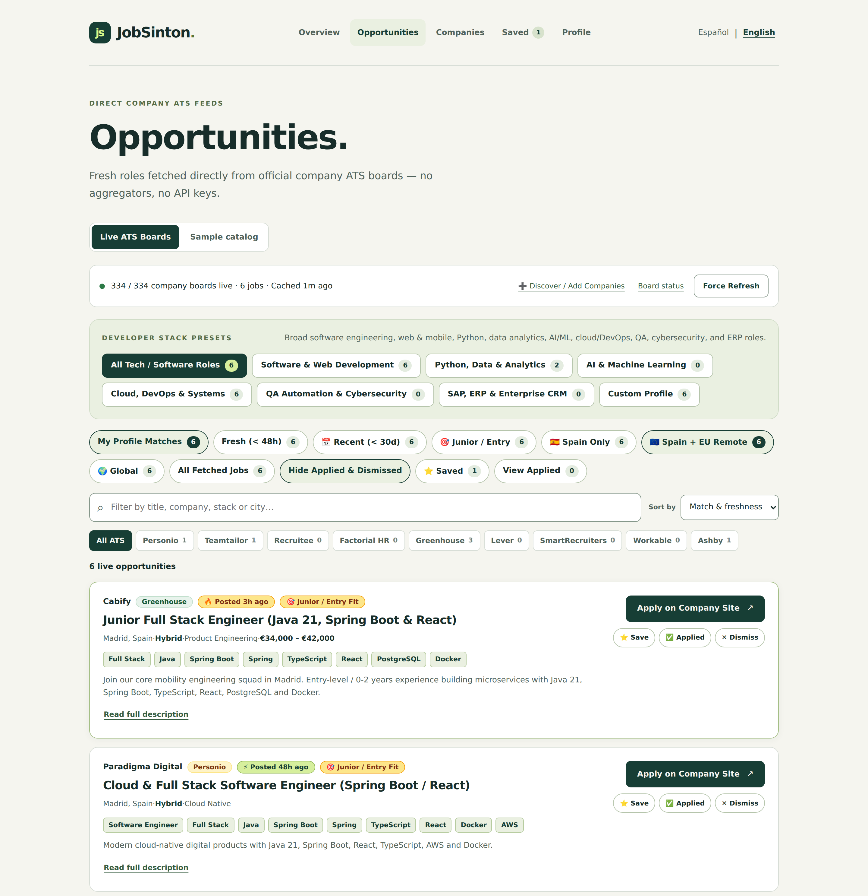
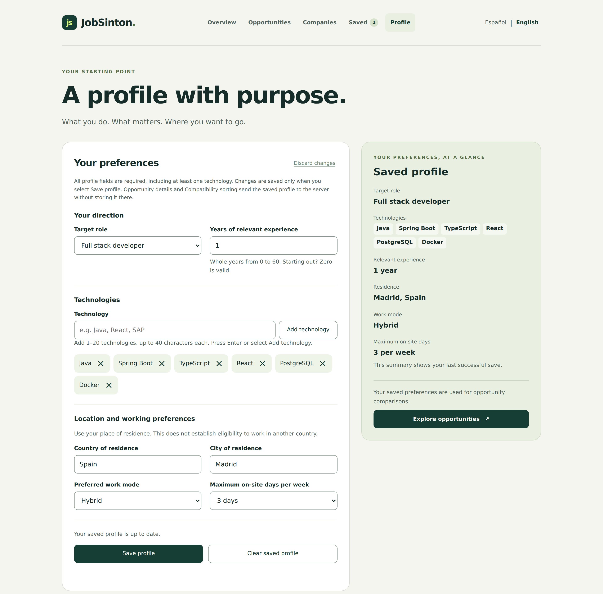
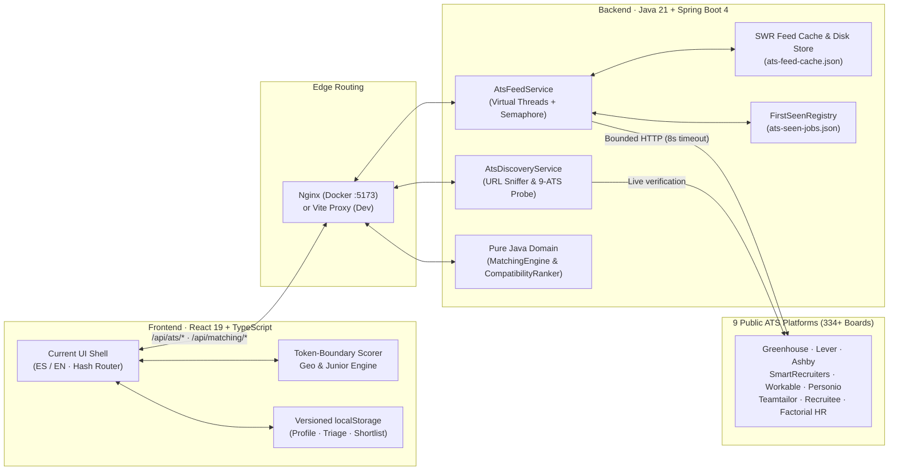

# JobSinton

**Job opportunities in tune with you.**

[](https://github.com/Garatech/jobsinton/actions/workflows/ci.yml)


[](LICENSE)

**JobSinton** is a zero-configuration, full-stack developer job radar and compatibility engine focused on **Spain and European tech hubs**. Instead of relying on rate-limited aggregators or paid API keys, it queries **334 verified company career boards directly across 9 public Applicant Tracking Systems (ATS)** in parallel using **Java 21 Virtual Threads**, filters out "fake remote" US/APAC-locked roles, highlights entry-level and fresh (`< 48h`) openings, and links candidates straight to each employer's official application page.



---

## Quickstart (1 Command with Docker)

With [Docker](https://docs.docker.com/get-docker/) installed, clone and launch the complete stack—**no API keys, `.env` files, or external database setup required**:

```bash
git clone https://github.com/Garatech/jobsinton.git
cd jobsinton
docker compose up --build -d
```

Open **[http://localhost:5173](http://localhost:5173)** in your browser. See **[INSTRUCTIONS.md](INSTRUCTIONS.md)** for container management, persistence details, and native local setup (`mvn spring-boot:run` + `npm run dev`).

---

## Product Tour

### 1. Live Multi-ATS Opportunities Board
Aggregates live openings across **Personio, Teamtailor, Recruitee, Factorial HR, Greenhouse, Lever, SmartRecruiters, Workable, and Ashby**, complete with **8 developer stack tracks**, **3-tier Spain/Europe geographical filtering**, **Junior/Entry & `< 48h` freshness badges**, and **1-click application triage** (`⭐ Save`, `✅ Applied`, `✕ Dismiss`).



### 2. Local-First Professional Profile & Explainable Compatibility
Candidates define their target discipline (across **14 tech roles**), technology stack, experience, residence, and hybrid/remote constraints locally in the browser (`localStorage`), driving both live ATS relevance scoring and deterministic, rule-based compatibility evaluations.



---

## Core Capabilities

- **334 Direct Company Boards Across 9 ATS Platforms:** Pre-seeded catalog covering engineering employers in Madrid, Barcelona, Valencia, Málaga, Bilbao, Sevilla, Zaragoza, major European hubs (Berlin, Amsterdam, Paris, Dublin, Lisbon, Stockholm, Munich), and EU-eligible remote teams—extensible from the UI via the **ATS Auto-Discovery Engine** (Career Page URL Sniffer & parallel 9-ATS slug probe).
- **8 Multi-Discipline Tech Tracks & Bilingual Matching:** Dedicated presets for *All Tech / Software Roles*, *Software & Web Development*, *Python, Data & Analytics*, *AI & Machine Learning*, *Cloud, DevOps & Systems*, *QA Automation & Cybersecurity*, *SAP, ERP & Enterprise CRM*, and *Custom Profile*, powered by token-boundary regex matching (`Java` never false-matches `JavaScript`; `SAP` never matches `asap`) with English and Spanish role aliases.
- **3-Tier Spain/EU Geo Filter & Anti-"Fake Remote" Engine:** Defaults to `🇪🇺 Spain + EU Remote`, preserving Spanish hubs and genuine pan-European/EMEA remote roles while blocking North America, LATAM, or APAC single-country residency locks—both at backend ingestion and client scoring.
- **Junior/Graduate Signal Detection & True Freshness Tracking:** Boosts entry-level, graduate, trainee, and internship roles (`🎯 Junior / Entry Fit`), demotes senior/principal/stale (`> 60d` / `> 90d`) listings, and tracks local first-seen timestamps (`FirstSeenRegistry`) so recruiter edits never fake a `< 24h` (`🔥`) badge.
- **Explainable Pure-Java Matching & Ranking Domain:** Separate deterministic rule engine (`matching` and `ranking` packages) that distinguishes hard constraint conflicts from advisory preferences and missing evidence—explicitly modeling profile compatibility rather than hiring probability.
- **Bilingual Interface (`Español` / `English`):** Instant localization across all views, filters, and matching explanations with accessible keyboard navigation and responsive `320px`–`1440px` layouts.

---

## System Architecture



---

## Engineering Highlights

- **Java 21 Virtual Threads & Bulkhead Isolation (`AtsFeedService`):** Fans out across 334+ boards concurrently on virtual threads bounded by a configurable `Semaphore`, 8-second per-request timeouts, and a 12 MiB stream cap. Upstream HTTP 4xx/5xx or malformed XML/JSON failures are isolated per board and surfaced in live health diagnostics without failing the feed.
- **Zero-Blocking Stale-While-Revalidate & Startup Pre-Warming (`AtsFeedCacheStore`):** Persists snapshots to `data/ats-feed-cache.json`, pre-warms asynchronously on `ApplicationReadyEvent`, serves cached opportunities in `< 50ms` while refreshing expired feeds in the background, and preserves cached offers during temporary network outages.
- **Protocol-Specific ATS Normalization:** Dedicated adapters handle double-encoded HTML in Greenhouse, Global/EU cluster failover in Lever and Greenhouse, dual-language (`es`/`en`) XML merging in Personio, RSS `xmlns:tt` namespaces in Teamtailor, prioritized JSON-LD/DOM detail enrichment in Factorial HR, cursor pagination in Workable `v3`, and targeted `?country=es` enterprise harvesting + on-demand detail hydration in SmartRecruiters.
- **Framework-Free Core Domain & Strict Client Contracts:** The `matching` and `ranking` packages use immutable Java records with zero Spring or I/O dependencies. On the client, every JSON payload is runtime-validated before state updates, with per-request `AbortController` cancellation preventing stale responses from overwriting newer UI state, and strict `https://` URL validation blocking `javascript:` XSS vectors.
- **Production-Grade Containerization & Offline CI (284 Automated Tests):** Multi-stage Dockerfiles build minimal Alpine images (`eclipse-temurin:21-jre-alpine` running as an unprivileged user + `nginx:1.27-alpine`). GitHub Actions runs **136 backend JUnit/MockMvc tests**, strict TypeScript compilation, and **148 Playwright desktop & mobile E2E tests** completely offline on every pull request.

---

## Repository Layout

```text
jobsinton/
├── backend/                     # Java 21 + Spring Boot 4 REST API
│   ├── Dockerfile               # Multi-stage Maven build -> non-root JRE 21 Alpine
│   └── src/
│       ├── main/java/.../
│       │   ├── providers/ats/   # 9 ATS adapters, SWR cache, discovery & first-seen stores
│       │   ├── matching/        # Pure Java rule-based compatibility engine & REST adapter
│       │   ├── ranking/         # Exact-fraction compatibility batch ranker
│       │   └── system/          # Health status endpoint (/api/status)
│       ├── main/resources/ats/  # companies.json (334 verified Spain & Europe boards)
│       └── test/                # 136 offline unit, adapter & MockMvc integration tests
├── frontend/                    # React 19 + strict TypeScript + Vite SPA
│   ├── Dockerfile               # Multi-stage Node 24 build -> Nginx 1.27 Alpine
│   ├── src/
│   │   ├── ats/                 # Stack presets, 3-tier geo filter, junior & keyword scorer
│   │   ├── pages/               # LiveJobsBoard, Home Radar, Companies, Detail & Saved views
│   │   ├── profile/             # 14-role profile schema, validation & localStorage guard
│   │   ├── matching/            # Explainable profile-vs-offer comparison UI
│   │   └── i18n/                # Bilingual ES / EN translations & locale detection
│   └── tests/                   # 148 Playwright desktop/mobile E2E & scoring specs
├── docs/                        # Architecture, ATS provider specs & domain contracts
├── docker-compose.yml           # 1-command orchestration with persistent jobsinton-data volume
└── INSTRUCTIONS.md              # Step-by-step Docker & local native operating guide
```

---

## Verification

Run the full offline test suite locally from the repository root:

```bash
mvn -B -ntp -f backend/pom.xml verify
npm --prefix frontend ci
npm --prefix frontend run build
npm --prefix frontend run test:e2e
```

---

## Documentation

- **[Boot & Operating Instructions (Docker & Local)](INSTRUCTIONS.md)**
- **[Documentation Index](docs/README.md)** · **[Application Architecture](docs/ARCHITECTURE.md)** · **[Multi-ATS Provider Engine](docs/ATS_PROVIDERS.md)**
- **[Matching Rule Contract](docs/MATCHING.md)** · **[Java Matching Engine](docs/MATCHING_ENGINE.md)** · **[Matching API](docs/MATCHING_API.md)** · **[Compatibility Ranking](docs/RANKING.md)**
- **[Professional Profile](docs/PROFILE.md)** · **[Visual Design System](docs/DESIGN.md)** · **[Localization (ES / EN)](docs/LANGUAGES.md)** · **[Development Guide](docs/DEVELOPMENT.md)**
- **[Project Scope & Roadmap](docs/PROJECT_PLAN.md)** · **[Contributing](CONTRIBUTING.md)** · **[Changelog](CHANGELOG.md)** · **[MIT License](LICENSE)**

---

Built by **Gara's Workshop** (`Garatech`).
